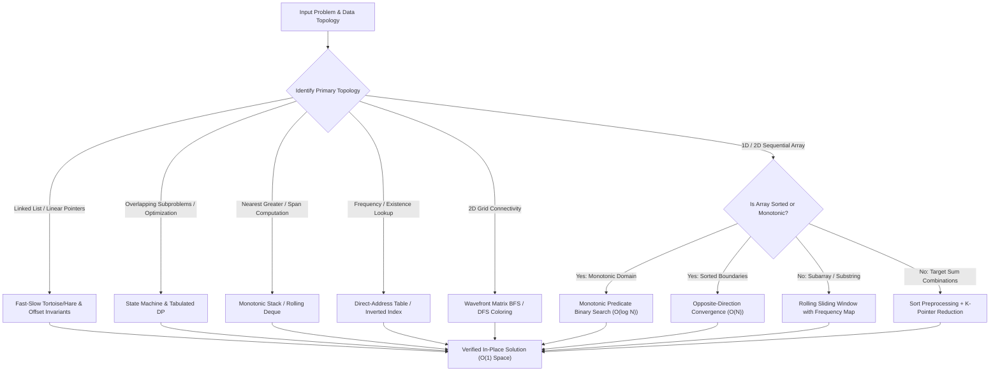

# Algorithmic Engineering & Core Data Structures

> High-performance, pattern-oriented algorithmic reference in modern C++ and Java, focusing on formal asymptotic complexity bounds, zero-allocation in-place mutations, cache locality, and state-machine dynamic programming.

**Languages:** Java (JDK 17+) | C++ (ISO C++17) &nbsp;|&nbsp; **Implementations:** 70+ Verified Solutions &nbsp;|&nbsp; **Focus:** Time/Space Asymptotics, Invariant Correctness, Low-Overhead Primitives

---

## Overview

Algorithmic interviews and large-scale software engineering demand more than brute-force pattern memorization. Real-world systems require optimal computational complexity, minimal garbage collection pressure, cache-conscious data access patterns, and rigorous loop invariants.

This repository serves as an enterprise-grade algorithmic catalog. Solutions are organized not by arbitrary sequence, but by fundamental computational paradigms: opposite/same-direction dual pointers, rolling sliding-window hash states, monotonic predicate binary search, monotonic stack and queue maintenance, bit-level transformations, and multi-state dynamic programming. Every implementation is written with production rigor: strict bounds checking, overflow-safe arithmetic, explicit time/space asymptotic guarantees, and deterministic local test harnesses.

---

## Algorithmic Taxonomy & Mathematical Formulations

The codebase is structured around core computational paradigms designed to guarantee optimal asymptotic bounds across diverse input topologies.

| Computational Paradigm | Primary Techniques | Input Topology / Invariant | Core Algorithmic Mechanism | Time Complexity | Auxiliary Space |
| :--- | :--- | :--- | :--- | :--- | :--- |
| **Opposite-Direction Pointers** | Squeeze sweep, pivot reduction | Sorted array or bilateral symmetry | Bidirectional boundary convergence terminating on predicate intersection | $\mathcal{O}(N)$ or $\mathcal{O}(N^2)$ | $\mathcal{O}(1)$ |
| **Fast & Slow Pointers** | Tortoise-and-hare, partition index | Linked lists, in-place arrays | Differential stride pointers preserving partition boundaries or cycle invariants | $\mathcal{O}(N)$ | $\mathcal{O}(1)$ |
| **Dynamic Sliding Window** | Frequency vector, contractive left | Contiguous sequence, subsegment | Monotonic rightward expansion paired with conditional leftward contraction | $\mathcal{O}(N)$ | $\mathcal{O}(1)$ or $\mathcal{O}(\Sigma)$ |
| **Monotonic Binary Search** | Predicate bisection, domain inflection | Monotonically sorted or rotated ranges | Midpoint convergence over discrete decision intervals with overflow-safe arithmetic | $\mathcal{O}(\log N)$ | $\mathcal{O}(1)$ |
| **Monotonic Stack & Deque** | Next Greater Element, span tracking | Unordered discrete sequences | Amortized $\mathcal{O}(1)$ maintenance of strictly monotonic elements | $\mathcal{O}(N)$ | $\mathcal{O}(N)$ |
| **Multi-Stage DP & State Machines** | Space compaction, prefix tracking | Overlapping subproblems, state DAG | Finite state transitions with space-compacted rolling registers | $\mathcal{O}(k \cdot N)$ | $\mathcal{O}(1)$ or $\mathcal{O}(k)$ |
| **Direct-Address & Inverted Indexing** | Hash collisions, bit-masking | Categorical keys, character frequencies | Inverted map indexing and 128-byte ASCII cache-line frequency buffers | $\mathcal{O}(N)$ | $\mathcal{O}(1)$ or $\mathcal{O}(U)$ |
| **Matrix & Graph Connectivity** | Multi-directional BFS / DFS | 2D orthogonal grid, adjacency lists | Queue-driven wavefront expansion with in-place cell coloring | $\mathcal{O}(V + E)$ | $\mathcal{O}(\min(M, N))$ |

### Mathematical Formulations

#### 1. Sliding Window Amortized Complexity Bound
For a sequence of length $N$, both the expansion pointer ($R$) and contraction pointer ($L$) move monotonically from left to right. Because each index is visited at most once by $R$ and at most once by $L$:

$$\sum_{i=1}^N (\Delta L_i + \Delta R_i) \le 2N \implies \mathcal{O}(N) \text{ amortized time}$$

#### 2. Monotonic Binary Search Convergence
Given a monotonic decision predicate $P: [L, R] \to \{0, 1\}$ where $P(x) \le P(x + 1)$:

$$\text{Find } x^* = \min \{ m \in [L, R] : P(m) = 1 \}$$

At each step, the search interval length satisfies $|R_{k+1} - L_{k+1}| \le \left\lfloor \frac{|R_k - L_k|}{2} \right\rfloor$, yielding guaranteed logarithmic convergence:

$$\text{Steps } k = \lceil \log_2 (R - L + 1) \rceil \implies \mathcal{O}(\log N)$$

#### 3. Stock State-Machine Dynamic Programming (Stock IV)
For at most $k$ transactions over an array of stock prices $P[0 \dots N-1]$, let $dp[i][j]$ denote the maximum profit achievable with at most $i$ transactions up to day $j$:

$$dp[i][j] = \max \left( dp[i][j-1], \; P[j] + \max_{0 \le m < j} \left( dp[i-1][m] - P[m] \right) \right)$$

By maintaining an online prefix maximum variable $\text{maxDiff} = \max_{0 \le m < j} (dp[i-1][m] - P[m])$, the inner search is reduced from $\mathcal{O}(N)$ to $\mathcal{O}(1)$, reducing overall complexity from $\mathcal{O}(k \cdot N^2)$ to $\mathcal{O}(k \cdot N)$:

$$\text{maxDiff}_{j} = \max(\text{maxDiff}_{j-1}, \; dp[i-1][j] - P[j])$$

#### 4. Monotonic Decreasing Stack Invariant
Let $S$ represent the index stack for finding the next greater element in an array $A$. For any two consecutive elements $S[t-1]$ and $S[t]$ residing in the stack:

$$A[S[t-1]] \ge A[S[t]], \quad \forall t \in [1, |S|-1]$$

Whenever $A[j] > A[S[\text{top}]]$, indices are popped and resolved. Every index is pushed exactly once and popped at most once, guaranteeing $\mathcal{O}(N)$ total operations.

---

## Key Engineering & Optimization Principles

- **Zero-Allocation & In-Place Pointer Reordering:** Implementations avoid superfluous heap allocations. Linked lists (such as LeetCode 61 and 876) and partition arrays (LeetCode 26, 80, 283) are transformed in-place using pointer rewiring and index swapping to achieve $\mathcal{O}(1)$ auxiliary memory overhead.
- **L1 Cache Locality & Direct-Address Buffers:** Where the input alphabet is bounded (ASCII / lowercase alphabetic), standard generic hash tables are bypassed in favor of fixed-size primitive arrays (`int freq[128]`). This avoids dynamic bucket resizing, pointer dereferencing, and hash collision penalties while fitting entirely within L1 data cache lines.
- **Arithmetic Overflow Mitigation:** All midpoint and range computations strictly avoid integer overflow via the standard invariant formula:
  $$\text{mid} = \text{low} + \frac{\text{high} - \text{low}}{2}$$
- **Loop Invariant Verification:** Algorithms enforce rigorous termination guarantees. Binary search routines consistently define boundary invariants ($[low, high]$ closed vs. $[low, high)$ half-open), and two-pointer loops preserve monotonic non-overlap invariants throughout iteration.
- **Self-Contained Deterministic Verification:** Solutions feature standalone `main` execution routines containing sample assertions and edge-case validations (empty inputs, singletons, negative numbers, extreme values).

---

## Algorithmic Decision Architecture



---

## Module Index & Technical Breakdown

### 1. Two Pointers: Opposite Direction
Bidirectional pointer convergence over sorted or bounded structures. Eliminates redundant subproblems by discarding monotonic search halves in $\mathcal{O}(1)$ per iteration.

| LeetCode ID | Problem Name | Language | Strategy / Core Mechanism | Time Complexity | Space Complexity |
| :--- | :--- | :--- | :--- | :--- | :--- |
| **LC 11** | Container With Most Water | C++ | Greedy inward movement of minimum bounding height | $\mathcal{O}(N)$ | $\mathcal{O}(1)$ |
| **LC 61** | Rotate List | Java | Length calculation, circular ring link, modular offset split | $\mathcal{O}(N)$ | $\mathcal{O}(1)$ |
| **LC 125** | Valid Palindrome | C++ | Alphanumeric filter with bidirectional character equality verification | $\mathcal{O}(N)$ | $\mathcal{O}(1)$ |
| **LC 167** | Two Sum II - Input Array Is Sorted | Java | Monotonic sum evaluation with inward boundary shift | $\mathcal{O}(N)$ | $\mathcal{O}(1)$ |
| **LC 611** | Valid Triangle Number | Java | Array sort + reverse longest side anchor + two-pointer pair count | $\mathcal{O}(N^2)$ | $\mathcal{O}(\log N)$ |
| **LC 881** | Boats to Save People | Java | Greedy pairing of heaviest and lightest elements within weight limit | $\mathcal{O}(N \log N)$ | $\mathcal{O}(\log N)$ |

### 2. Two Pointers: Same Direction (Fast & Slow)
Differential pointer indexing for in-place array manipulation and linked list traversal.

| LeetCode ID | Problem Name | Language | Strategy / Core Mechanism | Time Complexity | Space Complexity |
| :--- | :--- | :--- | :--- | :--- | :--- |
| **LC 19** | Remove Nth Node From End of List | C++ | $K$-step lead pointer traversal to locate removal precursor | $\mathcal{O}(N)$ | $\mathcal{O}(1)$ |
| **LC 26** | Remove Duplicates from Sorted Array | C++ | Unique element boundary write-pointer synchronization | $\mathcal{O}(N)$ | $\mathcal{O}(1)$ |
| **LC 283** | Move Zeroes | C++ | Non-zero element partition sweep with in-place swapping | $\mathcal{O}(N)$ | $\mathcal{O}(1)$ |
| **LC 876** | Middle of the Linked List | C++ | Floyd's cycle detection principle ($2\times$ fast pointer vs $1\times$ slow) | $\mathcal{O}(N)$ | $\mathcal{O}(1)$ |
| **LC 986** | Interval List Intersections | Java | Parallel sweep across sorted intervals using boundary comparison | $\mathcal{O}(M + N)$ | $\mathcal{O}(1)$ |

### 3. Two Pointers: Sliding Window
Dynamic and fixed-size contiguous sequence evaluation maintaining dynamic invariant constraints.

| LeetCode ID | Problem Name | Language | Strategy / Core Mechanism | Time Complexity | Space Complexity |
| :--- | :--- | :--- | :--- | :--- | :--- |
| **LC 3** | Longest Substring Without Repeating Characters | C++ | ASCII frequency / index tracker with left window boundary jump | $\mathcal{O}(N)$ | $\mathcal{O}(\min(N, \Sigma))$ |
| **LC 30** | Substring with Concatenation of All Words | C++ | Multi-offset sliding window over uniform token chunks | $\mathcal{O}(N \cdot L)$ | $\mathcal{O}(M \cdot L)$ |
| **LC 76** | Minimum Window Substring | C++ | Direct-address frequency table with match counter and left contraction | $\mathcal{O}(N + M)$ | $\mathcal{O}(1)$ |
| **LC 438** | Find All Anagrams in a String | C++ | Fixed window size $K$ sliding frequency match against target | $\mathcal{O}(N)$ | $\mathcal{O}(1)$ |
| **LC 567** | Permutation in String | C++ | Fixed rolling window frequency vector comparison | $\mathcal{O}(N)$ | $\mathcal{O}(1)$ |
| **LC 643** | Maximum Average Subarray I | C++ | Fixed-size rolling sum sliding window | $\mathcal{O}(N)$ | $\mathcal{O}(1)$ |
| **LC 2958** | Longest Subarray With at Most K Frequency | Java | Frequency map expansion with contractive left pointer | $\mathcal{O}(N)$ | $\mathcal{O}(U)$ |

### 4. Binary Search & Logarithmic Partitioning
Discrete bisection over ordered domains, rotated sequences, and mathematical invariants.

| LeetCode ID | Problem Name | Language | Strategy / Core Mechanism | Time Complexity | Space Complexity |
| :--- | :--- | :--- | :--- | :--- | :--- |
| **LC 33** | Search in Rotated Sorted Array | C++ | Sorted half identification with target range containment test | $\mathcal{O}(\log N)$ | $\mathcal{O}(1)$ |
| **LC 34** | Find First and Last Position | C++ | Dual binary search for lower and upper boundary bounds | $\mathcal{O}(\log N)$ | $\mathcal{O}(1)$ |
| **LC 35** | Search Insert Position | C++ | Standard lower-bound bisection ($A[i] \ge target$) | $\mathcal{O}(\log N)$ | $\mathcal{O}(1)$ |
| **LC 69** | Sqrt(x) | C++ | Monotonic integer range search with overflow-safe multiplication | $\mathcal{O}(\log x)$ | $\mathcal{O}(1)$ |
| **LC 153** | Find Minimum in Rotated Sorted Array | C++ / Java | Comparison against right boundary to isolate inflection point | $\mathcal{O}(\log N)$ | $\mathcal{O}(1)$ |
| **LC 154** | Find Minimum in Rotated Sorted Array II | Java | Duplicate resolution via high-index boundary reduction | $\mathcal{O}(\log N)$ avg | $\mathcal{O}(1)$ |
| **LC 162** | Find Peak Element | C++ | Slope gradient bisection ($A[mid] > A[mid+1]$) | $\mathcal{O}(\log N)$ | $\mathcal{O}(1)$ |
| **LC 704** | Binary Search | C++ | Canonical closed-interval $[low, high]$ bisection | $\mathcal{O}(\log N)$ | $\mathcal{O}(1)$ |
| **LC 74** | Search a 2D Matrix | Java | Virtual 1D index mapping: $\text{row} = \lfloor \frac{m}{C} \rfloor, \text{col} = m \pmod C$ | $\mathcal{O}(\log(R \cdot C))$ | $\mathcal{O}(1)$ |

### 5. Multi-Pointer Sum & Trapping Water
Advanced multidimensional pointer coordination and boundary elevation tracking.

| LeetCode ID | Problem Name | Language | Strategy / Core Mechanism | Time Complexity | Space Complexity |
| :--- | :--- | :--- | :--- | :--- | :--- |
| **LC 16** | 3Sum Closest | C++ | Sort + fixed anchor + bilateral two-pointer distance minimization | $\mathcal{O}(N^2)$ | $\mathcal{O}(\log N)$ |
| **LC 18** | 4Sum | C++ | Nested dual anchors + inward two-pointer with duplicate skipping | $\mathcal{O}(N^3)$ | $\mathcal{O}(\log N)$ |
| **LC 42** | Trapping Rain Water | C++ | Bilateral maximum elevation tracking with inward pointer convergence | $\mathcal{O}(N)$ | $\mathcal{O}(1)$ |
| **LC 80** | Remove Duplicates from Sorted Array II | C++ | Fast/slow pointer keeping count $\le 2$ via $A[fast] \ne A[slow-2]$ | $\mathcal{O}(N)$ | $\mathcal{O}(1)$ |
| **LC 680** | Valid Palindrome II | C++ | Two pointers with single-character branch mismatch tolerance | $\mathcal{O}(N)$ | $\mathcal{O}(1)$ |

### 6. Dynamic Programming & State Machines
Decomposition into optimal substructure with memoization and iterative state compaction.

| LeetCode ID | Problem Name | Language | Strategy / Core Mechanism | Time Complexity | Space Complexity |
| :--- | :--- | :--- | :--- | :--- | :--- |
| **LC 70** | Climbing Stairs | C++ | Fibonacci transition $dp[i] = dp[i-1] + dp[i-2]$ | $\mathcal{O}(N)$ | $\mathcal{O}(1)$ |
| **LC 118** | Pascal's Triangle | C++ | Dynamic 2D construction using adjacent parent sum | $\mathcal{O}(N^2)$ | $\mathcal{O}(1)$ |
| **LC 121** | Best Time to Buy and Sell Stock I | Java | Prefix minimum price maintenance with max single-day spread | $\mathcal{O}(N)$ | $\mathcal{O}(1)$ |
| **LC 122** | Best Time to Buy and Sell Stock II | Java | Greedy peak-valley accumulation: $\sum \max(0, P[i] - P[i-1])$ | $\mathcal{O}(N)$ | $\mathcal{O}(1)$ |
| **LC 123** | Best Time to Buy and Sell Stock III | Java | 4-state finite state machine (Buy1, Sell1, Buy2, Sell2) | $\mathcal{O}(N)$ | $\mathcal{O}(1)$ |
| **LC 188** | Best Time to Buy and Sell Stock IV | Java | Generalized $K$-transaction DP with online $\text{maxDiff}$ optimization | $\mathcal{O}(k \cdot N)$ | $\mathcal{O}(k \cdot N)$ |
| **LC 198** | House Robber | C++ | Non-adjacent optimal choice: $\max(dp[i-1], dp[i-2] + nums[i])$ | $\mathcal{O}(N)$ | $\mathcal{O}(1)$ |
| **LC 322** | Coin Change | C++ | Unbounded knapsack minimum-coin bottom-up DP | $\mathcal{O}(S \cdot N)$ | $\mathcal{O}(S)$ |
| **LC 338** | Counting Bits | C++ | Bitwise transition: $dp[i] = dp[i \gg 1] + (i \ \& \ 1)$ | $\mathcal{O}(N)$ | $\mathcal{O}(1)$ |
| **LC 1137** | N-th Tribonacci Number | C++ | Rolling 3-variable recurrence register | $\mathcal{O}(N)$ | $\mathcal{O}(1)$ |
| **Graph** | Floyd-Warshall (`shortestPair.cpp`) | C++ | All-pairs shortest paths via dynamic triple nested intermediate nodes | $\mathcal{O}(V^3)$ | $\mathcal{O}(V^2)$ |

### 7. Monotonic Stack & Linear Scaffolding
LIFO structure maintaining strict ordering invariants for immediate boundary resolution.

| LeetCode ID | Problem Name | Language | Strategy / Core Mechanism | Time Complexity | Space Complexity |
| :--- | :--- | :--- | :--- | :--- | :--- |
| **LC 20** | Valid Parentheses | Java | Bracket matching with top-of-stack validation | $\mathcal{O}(N)$ | $\mathcal{O}(N)$ |
| **LC 71** | Simplify Path | Java | POSIX path tokenization with directory pop/push resolution | $\mathcal{O}(N)$ | $\mathcal{O}(N)$ |
| **LC 143** | Reorder List | Java | Stack-assisted node collection paired with dual-end link splicing | $\mathcal{O}(N)$ | $\mathcal{O}(N)$ |
| **LC 150** | Evaluate Reverse Polish Notation | Java | Operand stack with binary operator reduction | $\mathcal{O}(N)$ | $\mathcal{O}(N)$ |
| **LC 682** | Baseball Game | Java | Record state simulation via dynamic score stack | $\mathcal{O}(N)$ | $\mathcal{O}(N)$ |
| **LC 739** | Daily Temperatures | Java | Monotonic decreasing index stack for next warmer day span | $\mathcal{O}(N)$ | $\mathcal{O}(N)$ |

### 8. Hash Mapping, Sets & Frequency Tables
Direct-address lookup, frequency histogramming, and inverted indexing.

| LeetCode ID | Problem Name | Language | Strategy / Core Mechanism | Time Complexity | Space Complexity |
| :--- | :--- | :--- | :--- | :--- | :--- |
| **LC 1** | Two Sum | Java | Single-pass inverted index mapping complement to index | $\mathcal{O}(N)$ | $\mathcal{O}(N)$ |
| **LC 169** | Majority Element | Java | Frequency map counting / linear hash aggregation | $\mathcal{O}(N)$ | $\mathcal{O}(N)$ |
| **LC 205** | Isomorphic Strings | Java | Dual forward-backward character mapping validation | $\mathcal{O}(N)$ | $\mathcal{O}(1)$ |
| **LC 217** | Contains Duplicate | Java | Hash set insertion with early-exit duplicate detection | $\mathcal{O}(N)$ | $\mathcal{O}(N)$ |
| **LC 219** | Contains Duplicate II | Java | Sliding hash map tracking latest index within distance $K$ | $\mathcal{O}(N)$ | $\mathcal{O}(K)$ |
| **LC 242** | Valid Anagram | Java | Frequency counting array with delta cancellation | $\mathcal{O}(N)$ | $\mathcal{O}(1)$ |
| **LC 349** | Intersection of Two Arrays | Java | Hash set intersection filtering duplicates | $\mathcal{O}(N + M)$ | $\mathcal{O}(N)$ |
| **LC 383** | Ransom Note | Java | Frequency count subtraction over source character set | $\mathcal{O}(N + M)$ | $\mathcal{O}(1)$ |
| **LC 387** | First Unique Character in a String | Java | Two-pass frequency histogram and first unique scan | $\mathcal{O}(N)$ | $\mathcal{O}(1)$ |
| **LC 2215** | Find the Difference of Two Arrays | Java | Dual set construction with symmetric difference subtraction | $\mathcal{O}(N + M)$ | $\mathcal{O}(N + M)$ |

### 9. Queues, Sorting & Backtracking
FIFO buffering, permutation trees with branch pruning, and categorical hash grouping.

| LeetCode ID | Problem Name | Language | Strategy / Core Mechanism | Time Complexity | Space Complexity |
| :--- | :--- | :--- | :--- | :--- | :--- |
| **LC 47** | Permutations II | C++ | Backtracking with sorted frequency array to prune duplicate branches | $\mathcal{O}(N \cdot N!)$ | $\mathcal{O}(N)$ |
| **LC 49** | Group Anagrams | C++ | Canonical sorted key indexing in unordered hash map | $\mathcal{O}(N \cdot K \log K)$ | $\mathcal{O}(N \cdot K)$ |
| **LC 225** | Implement Stack using Queues | Java | Single queue rotation on push to preserve LIFO order | $\mathcal{O}(N)$ push, $\mathcal{O}(1)$ pop | $\mathcal{O}(N)$ |
| **LC 933** | Number of Recent Calls | Java | Monotonic sliding time window queue eviction ($t - 3000$) | $\mathcal{O}(1)$ amortized | $\mathcal{O}(W)$ |

### 10. Matrices & Graph Algorithms
2D transformations and topological graph traversals.

| LeetCode ID | Problem Name | Language | Strategy / Core Mechanism | Time Complexity | Space Complexity |
| :--- | :--- | :--- | :--- | :--- | :--- |
| **LC 200** | Number of Islands | Java | 4-directional matrix BFS traversal with visited coordinate tracking | $\mathcal{O}(M \cdot N)$ | $\mathcal{O}(\min(M, N))$ |
| **LC 867** | Transpose Matrix | Java | Dimension inversion: $B[j][i] = A[i][j]$ | $\mathcal{O}(M \cdot N)$ | $\mathcal{O}(M \cdot N)$ |
| **LC 1572** | Matrix Diagonal Sum | Java | Single-pass primary and secondary diagonal accumulation | $\mathcal{O}(N)$ | $\mathcal{O}(1)$ |

---

## Repository Structure

```
.
|-- 2D-Array/                               # Matrix transformations and linear algebra
|   |-- MatrixDiagonalSum.java              # LC 1572: Matrix Diagonal Sum
|   `-- TransposeMatrix.java                # LC 867: Transpose Matrix
|-- Best-Time-To-Buy-And-Sell-Stocks/       # Finite-state machine and DP progressions
|   |-- 121_Best_Time_To_Buy_And_Sell_Stock_I.java
|   |-- 122_Best_Time_To_Buy_And_Sell_Stock_II.java
|   |-- 123_Best_Time_To_Buy_And_Sell_Stock_III.java
|   `-- 188_Best_Time_To_Buy_And_Sell_Stock_IV.java
|-- Binary-Search-2D-Arrays/                # Multi-dimensional & rotated array bisections
|   |-- FindMinimumInRotatedSortedArrayII .java
|   |-- FindMinimumInSortedArray.java
|   `-- SearchA2DArray.java                 # LC 74: Search a 2D Matrix
|-- Binary-Search-Two-Pointers/             # Phase-structured search & pointer patterns
|   |-- Phase1_Core_BS/                     # Core binary search primitives (LC 33, 34, 35, 69, 153, 162, 704)
|   `-- Phase2_TwoPointers/                 # Advanced pointer sweeps (LC 11, 16, 18, 42, 80, 283, 680)
|-- Dynamic_Programming/                    # Iterative DP and combinatorial optimization
|   |-- Phase_1_DP_Basics/                  # Fibonacci, bit counting, staircase transitions
|   `-- Phase_2_DP_Medium/                  # Coin change, Pascal's triangle, House Robber, Floyd-Warshall
|-- Graph/                                  # Graph traversal & connectivity algorithms
|   `-- IslandCounter.java                  # LC 200: Number of Islands (BFS Wavefront)
|-- HashMap/                                # Hash sets, frequency tables & bijective mappings (10 files)
|-- Queue/                                  # Queue-based state trackers and adapters (LC 225, 933)
|-- Sorting/                                # Backtracking and canonical key grouping (LC 47, 49)
|-- Stack/                                  # Monotonic stacks and LIFO evaluation (LC 20, 71, 143, 150, 682, 739)
`-- Two_Pointers/                           # Specialized two-pointer taxonomies
    |-- Opposite_Direction/                 # LC 11, 61, 125, 167, 611, 881
    |-- Same_Direction/                     # LC 19, 26, 283, 876, 986
    `-- Sliding_Window/                     # LC 3, 30, 76, 438, 567, 643, 2958
```

---

## Technical Standards & Build Environment

| Dimension | Specification | Engineering Standard |
| :--- | :--- | :--- |
| **Java Platform** | OpenJDK 17+ (LTS) | Strict object typing, minimal wrapper unboxing, zero reflection overhead |
| **C++ Standard** | ISO C++17 / C++20 | Modern STL (`std::vector`, `std::string`, `std::unordered_map`), references, zero-copy `std::string_view` |
| **Memory Model** | Cache-Conscious / In-Place | Direct-address tables (`int freq[128]`), in-place pointer mutations |
| **Arithmetic Safety** | Overflow Protection | Half-distance midpoint calculations (`low + (high - low) / 2`) |
| **Dependencies** | Pure Standard Library | Zero external third-party dependencies; 100% self-contained |

---

## Compilation & Verification Guide

All implementations include self-contained execution drivers or test cases for independent verification.

### Compiling and Running Java Implementations

```bash
# Example 1: Compile and run Dynamic Programming (Stock Series)
javac Best-Time-To-Buy-And-Sell-Stocks/188_Best_Time_To_Buy_And_Sell_Stock_IV.java
java -cp Best-Time-To-Buy-And-Sell-Stocks Best_Time_To_Buy_And_Sell_Stock.Best_Time_To_Buy_And_Sell_Stock_IV

# Example 2: Compile and run Monotonic Stack (Daily Temperatures)
javac Stack/DailyTemperatures.java
java -cp Stack DailyTemperatue

# Example 3: Compile and run Opposite Direction Pointers (Valid Triangle Number)
javac Two_Pointers/Opposite_Direction/611_Valid_Triangle_Number.java
java -cp Two_Pointers/Opposite_Direction Two_Pointers.Opposite_Direction.Valid_Triangle_Number
```

### Compiling and Running C++ Implementations

```bash
# Example 1: Compile with C++17 and -O3 optimization (Sliding Window: Minimum Window Substring)
g++ -std=c++17 -O3 -Wall -Wextra Two_Pointers/Sliding_Window/76_Minimum_Window_Substring.cpp -o min_window
./min_window

# Example 2: Compile and run Binary Search (Search in Rotated Sorted Array)
g++ -std=c++17 -O3 -Wall -Wextra Binary-Search-Two-Pointers/Phase1_Core_BS/33_Search_in_Rotated_Sorted_Array.cpp -o rotated_search
./rotated_search

# Example 3: Compile and run Dynamic Programming (Coin Change)
g++ -std=c++17 -O3 -Wall -Wextra Dynamic_Programming/Phase_2_DP_Medium/coinChange.cpp -o coin_change
./coin_change
```
