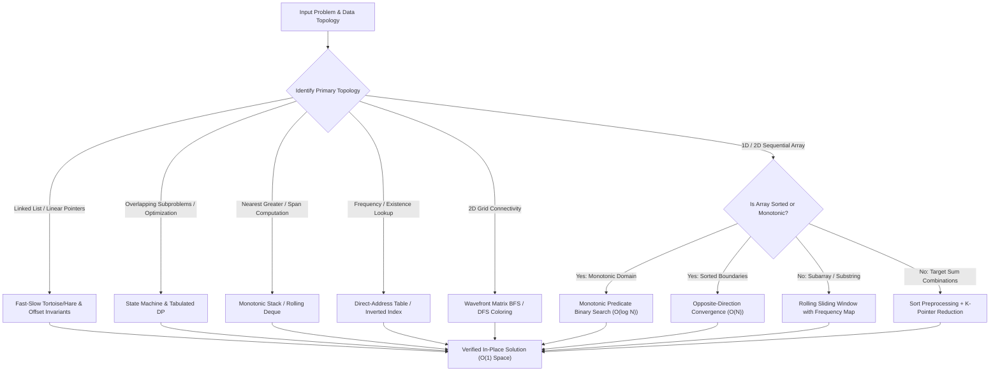

# Algorithmic Engineering & Core Data Structures

> High-performance, pattern-oriented algorithmic reference in modern C++ and Java, focusing on formal asymptotic complexity bounds, zero-allocation in-place mutations, cache locality, and state-machine dynamic programming.

**Languages:** Java (JDK 17+) | C++ (ISO C++17) &nbsp;|&nbsp; **Implementations:** 68 Production-Grade Solutions &nbsp;|&nbsp; **Focus:** Time/Space Asymptotics, Invariant Correctness, Low-Overhead Primitives

---

## Overview

Algorithmic interviews and large-scale software engineering demand more than brute-force pattern memorization. Real-world systems require optimal computational complexity, minimal garbage collection pressure, cache-conscious data access patterns, and rigorous loop invariants.

This repository serves as an enterprise-grade algorithmic catalog. Solutions are organized not by arbitrary sequence or daily logs, but by fundamental computational paradigms: opposite/same-direction dual pointers, rolling sliding-window hash states, monotonic predicate binary search, monotonic stack and queue maintenance, bit-level transformations, and multi-state dynamic programming. Every implementation is written with production rigor: strict bounds checking, overflow-safe arithmetic, explicit time/space asymptotic guarantees, and deterministic local test harnesses.

---

## Algorithmic Taxonomy & Mathematical Formulations

The codebase is structured around core computational paradigms designed to guarantee optimal asymptotic bounds across diverse input topologies.

| Computational Paradigm | Primary Techniques | Input Topology / Invariant | Core Algorithmic Mechanism | Time Complexity | Auxiliary Space |
| :--- | :--- | :--- | :--- | :--- | :--- |
| **Opposite-Direction Pointers** | Squeeze sweep, pivot reduction | Sorted array or bilateral symmetry | Bidirectional boundary convergence terminating on predicate intersection | $\mathcal{O}(N)$ or $\mathcal{O}(N^2)$ | $\mathcal{O}(1)$ |
| **Fast & Slow Pointers** | Tortoise-and-hare, partition index | Linked lists, in-place arrays | Differential stride pointers preserving partition boundaries or cycle invariants | $\mathcal{O}(N)$ | $\mathcal{O}(1)$ |
| **Dynamic Sliding Window** | Frequency vector, contractive left | Contiguous sequence, subsegment | Monotonic rightward expansion paired with conditional leftward contraction | $\mathcal{O}(N)$ | $\mathcal{O}(1)$ or $\mathcal{O}(\Sigma)$ |
| **Monotonic Binary Search** | Predicate bisection, domain inflection | Monotonically sorted or rotated ranges | Midpoint convergence over discrete decision intervals with overflow-safe arithmetic | $\mathcal{O}(\log N)$ | $\mathcal{O}(1)$ |
| **Monotonic Stack & Deque** | Next Greater Element, span tracking | Unordered discrete sequences | Amortized $\mathcal{O}(1)$ maintenance of strictly monotonic elements | $\mathcal{O}(N)$ | $\mathcal{O}(N)$ |
| **Multi-Stage DP & State Machines** | Space compaction, prefix tracking | Overlapping subproblems, state DAG | Finite state transitions with space-compacted rolling registers | $\mathcal{O}(k \cdot N)$ | $\mathcal{O}(1)$ or $\mathcal{O}(k)$ |
| **Direct-Address & Inverted Indexing** | Hash collisions, bit-masking | Categorical keys, character frequencies | Inverted map indexing and 128-byte ASCII cache-line frequency buffers | $\mathcal{O}(N)$ | $\mathcal{O}(1)$ or $\mathcal{O}(U)$ |
| **Matrix & Graph Connectivity** | Multi-directional BFS / DFS | 2D orthogonal grid, adjacency lists | Queue-driven wavefront expansion with in-place cell coloring | $\mathcal{O}(V + E)$ | $\mathcal{O}(\min(M, N))$ |

### Mathematical Formulations

#### 1. Sliding Window Amortized Complexity Bound
For a sequence of length $N$, both the expansion pointer ($R$) and contraction pointer ($L$) move monotonically from left to right. Because each index is visited at most once by $R$ and at most once by $L$:

$$\sum_{i=1}^N (\Delta L_i + \Delta R_i) \le 2N \implies \mathcal{O}(N) \text{ amortized time}$$

#### 2. Monotonic Binary Search Convergence
Given a monotonic decision predicate $P: [L, R] \to \{0, 1\}$ where $P(x) \le P(x + 1)$:

$$\text{Find } x^* = \min \{ m \in [L, R] : P(m) = 1 \}$$

At each step, the search interval length satisfies $|R_{k+1} - L_{k+1}| \le \left\lfloor \frac{|R_k - L_k|}{2} \right\rfloor$, yielding guaranteed logarithmic convergence:

$$\text{Steps } k = \lceil \log_2 (R - L + 1) \rceil \implies \mathcal{O}(\log N)$$

#### 3. Stock State-Machine Dynamic Programming (Stock IV)
For at most $k$ transactions over an array of stock prices $P[0 \dots N-1]$, let $dp[i][j]$ denote the maximum profit achievable with at most $i$ transactions up to day $j$:

$$dp[i][j] = \max \left( dp[i][j-1], \; P[j] + \max_{0 \le m < j} \left( dp[i-1][m] - P[m] \right) \right)$$

By maintaining an online prefix maximum variable $\text{maxDiff} = \max_{0 \le m < j} (dp[i-1][m] - P[m])$, the inner search is reduced from $\mathcal{O}(N)$ to $\mathcal{O}(1)$, reducing overall complexity from $\mathcal{O}(k \cdot N^2)$ to $\mathcal{O}(k \cdot N)$:

$$\text{maxDiff}_{j} = \max(\text{maxDiff}_{j-1}, \; dp[i-1][j] - P[j])$$

#### 4. Monotonic Decreasing Stack Invariant
Let $S$ represent the index stack for finding the next greater element in an array $A$. For any two consecutive elements $S[t-1]$ and $S[t]$ residing in the stack:

$$A[S[t-1]] \ge A[S[t]], \quad \forall t \in [1, |S|-1]$$

Whenever $A[j] > A[S[\text{top}]]$, indices are popped and resolved. Every index is pushed exactly once and popped at most once, guaranteeing $\mathcal{O}(N)$ total operations.

---

## Key Engineering & Optimization Principles

- **Zero-Allocation & In-Place Pointer Reordering:** Implementations avoid superfluous heap allocations. Linked lists (such as LeetCode 61 and 876) and partition arrays (LeetCode 26, 80, 283) are transformed in-place using pointer rewiring and index swapping to achieve $\mathcal{O}(1)$ auxiliary memory overhead.
- **L1 Cache Locality & Direct-Address Buffers:** Where the input alphabet is bounded (ASCII / lowercase alphabetic), standard generic hash tables are bypassed in favor of fixed-size primitive arrays (`int freq[128]`). This avoids dynamic bucket resizing, pointer dereferencing, and hash collision penalties while fitting entirely within L1 data cache lines.
- **Arithmetic Overflow Mitigation:** All midpoint and range computations strictly avoid integer overflow via the standard invariant formula:
  $$\text{mid} = \text{low} + \frac{\text{high} - \text{low}}{2}$$
- **Loop Invariant Verification:** Algorithms enforce rigorous termination guarantees. Binary search routines consistently define boundary invariants ($[low, high]$ closed vs. $[low, high)$ half-open), and two-pointer loops preserve monotonic non-overlap invariants throughout iteration.
- **Self-Contained Deterministic Verification:** Solutions feature standalone `main` execution routines containing sample assertions and edge-case validations (empty inputs, singletons, negative numbers, extreme values).

---

## Algorithmic Decision Architecture



---

## Module Index & Technical Breakdown

### 1. Arrays, Inverted Hashing & Matrix
Direct-address lookup, frequency histogramming, inverted indexing, and 2D matrix transformations.

| LeetCode ID | Problem Name | File Path | Language | Strategy / Core Mechanism | Time Complexity | Space Complexity |
| :--- | :--- | :--- | :--- | :--- | :--- | :--- |
| **LC 1** | Two Sum | `Arrays_and_Hashing/0001_Two_Sum.java` | Java | Single-pass inverted index mapping complement to index | $\mathcal{O}(N)$ | $\mathcal{O}(N)$ |
| **LC 49** | Group Anagrams | `Arrays_and_Hashing/0049_Group_Anagrams.cpp` | C++ | Canonical sorted key indexing in unordered hash map | $\mathcal{O}(N \cdot K \log K)$ | $\mathcal{O}(N \cdot K)$ |
| **LC 169** | Majority Element | `Arrays_and_Hashing/0169_Majority_Element.java` | Java | Frequency map counting / linear hash aggregation | $\mathcal{O}(N)$ | $\mathcal{O}(N)$ |
| **LC 205** | Isomorphic Strings | `Arrays_and_Hashing/0205_Isomorphic_Strings.java` | Java | Dual forward-backward character mapping validation | $\mathcal{O}(N)$ | $\mathcal{O}(1)$ |
| **LC 217** | Contains Duplicate | `Arrays_and_Hashing/0217_Contains_Duplicate.java` | Java | Hash set insertion with early-exit duplicate detection | $\mathcal{O}(N)$ | $\mathcal{O}(N)$ |
| **LC 219** | Contains Duplicate II | `Arrays_and_Hashing/0219_Contains_Duplicate_II.java` | Java | Sliding hash map tracking latest index within distance $K$ | $\mathcal{O}(N)$ | $\mathcal{O}(K)$ |
| **LC 242** | Valid Anagram | `Arrays_and_Hashing/0242_Valid_Anagram.java` | Java | Frequency counting array with delta cancellation | $\mathcal{O}(N)$ | $\mathcal{O}(1)$ |
| **LC 349** | Intersection of Two Arrays | `Arrays_and_Hashing/0349_Intersection_of_Two_Arrays.java` | Java | Hash set intersection filtering duplicates | $\mathcal{O}(N + M)$ | $\mathcal{O}(N)$ |
| **LC 383** | Ransom Note | `Arrays_and_Hashing/0383_Ransom_Note.java` | Java | Frequency count subtraction over source character set | $\mathcal{O}(N + M)$ | $\mathcal{O}(1)$ |
| **LC 387** | First Unique Character in a String | `Arrays_and_Hashing/0387_First_Unique_Character_in_a_String.java` | Java | Two-pass frequency histogram and first unique scan | $\mathcal{O}(N)$ | $\mathcal{O}(1)$ |
| **LC 2215** | Find the Difference of Two Arrays | `Arrays_and_Hashing/2215_Find_the_Difference_of_Two_Arrays.java` | Java | Dual set construction with symmetric difference subtraction | $\mathcal{O}(N + M)$ | $\mathcal{O}(N + M)$ |
| **LC 867** | Transpose Matrix | `Arrays_and_Hashing/Matrix/0867_Transpose_Matrix.java` | Java | Dimension inversion: $B[j][i] = A[i][j]$ | $\mathcal{O}(M \cdot N)$ | $\mathcal{O}(M \cdot N)$ |
| **LC 1572** | Matrix Diagonal Sum | `Arrays_and_Hashing/Matrix/1572_Matrix_Diagonal_Sum.java` | Java | Single-pass primary and secondary diagonal accumulation | $\mathcal{O}(N)$ | $\mathcal{O}(1)$ |

### 2. Two Pointers & Sliding Window
Bidirectional pointer convergence, fast-and-slow differential strides, and dynamic-window constraints.

#### Opposite Direction
| LeetCode ID | Problem Name | File Path | Language | Strategy / Core Mechanism | Time Complexity | Space Complexity |
| :--- | :--- | :--- | :--- | :--- | :--- | :--- |
| **LC 11** | Container With Most Water | `Two_Pointers/Opposite_Direction/0011_Container_With_Most_Water.cpp` | C++ | Greedy inward movement of minimum bounding height | $\mathcal{O}(N)$ | $\mathcal{O}(1)$ |
| **LC 16** | 3Sum Closest | `Two_Pointers/Opposite_Direction/0016_3Sum_Closest.cpp` | C++ | Sort + fixed anchor + bilateral two-pointer distance minimization | $\mathcal{O}(N^2)$ | $\mathcal{O}(\log N)$ |
| **LC 18** | 4Sum | `Two_Pointers/Opposite_Direction/0018_4Sum.cpp` | C++ | Nested dual anchors + inward two-pointer with duplicate skipping | $\mathcal{O}(N^3)$ | $\mathcal{O}(\log N)$ |
| **LC 42** | Trapping Rain Water | `Two_Pointers/Opposite_Direction/0042_Trapping_Rain_Water.cpp` | C++ | Bilateral maximum elevation tracking with inward convergence | $\mathcal{O}(N)$ | $\mathcal{O}(1)$ |
| **LC 61** | Rotate List | `Two_Pointers/Opposite_Direction/0061_Rotate_List.java` | Java | Length calculation, circular ring link, modular offset split | $\mathcal{O}(N)$ | $\mathcal{O}(1)$ |
| **LC 125** | Valid Palindrome | `Two_Pointers/Opposite_Direction/0125_Valid_Palindrome.cpp` | C++ | Alphanumeric filter with bidirectional character equality verification | $\mathcal{O}(N)$ | $\mathcal{O}(1)$ |
| **LC 167** | Two Sum II - Input Array Is Sorted | `Two_Pointers/Opposite_Direction/0167_Two_Sum_II.java` | Java | Monotonic sum evaluation with inward boundary shift | $\mathcal{O}(N)$ | $\mathcal{O}(1)$ |
| **LC 611** | Valid Triangle Number | `Two_Pointers/Opposite_Direction/0611_Valid_Triangle_Number.java` | Java | Array sort + reverse longest side anchor + two-pointer pair count | $\mathcal{O}(N^2)$ | $\mathcal{O}(\log N)$ |
| **LC 680** | Valid Palindrome II | `Two_Pointers/Opposite_Direction/0680_Valid_Palindrome_II.cpp` | C++ | Two pointers with single-character branch mismatch tolerance | $\mathcal{O}(N)$ | $\mathcal{O}(1)$ |
| **LC 881** | Boats to Save People | `Two_Pointers/Opposite_Direction/0881_Boats_To_Save_People.java` | Java | Greedy pairing of heaviest and lightest elements within weight limit | $\mathcal{O}(N \log N)$ | $\mathcal{O}(\log N)$ |

#### Same Direction (Fast & Slow)
| LeetCode ID | Problem Name | File Path | Language | Strategy / Core Mechanism | Time Complexity | Space Complexity |
| :--- | :--- | :--- | :--- | :--- | :--- | :--- |
| **LC 19** | Remove Nth Node From End of List | `Two_Pointers/Same_Direction/0019_Remove_Nth_Node_From_End_of_List.cpp` | C++ | $K$-step lead pointer traversal to locate removal precursor | $\mathcal{O}(N)$ | $\mathcal{O}(1)$ |
| **LC 26** | Remove Duplicates from Sorted Array | `Two_Pointers/Same_Direction/0026_Remove_Duplicates_from_Sorted_Array.cpp` | C++ | Unique element boundary write-pointer synchronization | $\mathcal{O}(N)$ | $\mathcal{O}(1)$ |
| **LC 80** | Remove Duplicates from Sorted Array II | `Two_Pointers/Same_Direction/0080_Remove_Duplicates_from_Sorted_Array_II.cpp` | C++ | Fast/slow pointer keeping count $\le 2$ via $A[fast] \ne A[slow-2]$ | $\mathcal{O}(N)$ | $\mathcal{O}(1)$ |
| **LC 283** | Move Zeroes | `Two_Pointers/Same_Direction/0283_Move_Zeroes.cpp` | C++ | Non-zero element partition sweep with in-place swapping | $\mathcal{O}(N)$ | $\mathcal{O}(1)$ |
| **LC 876** | Middle of the Linked List | `Two_Pointers/Same_Direction/0876_Middle_of_the_Linked_List.cpp` | C++ | Floyd's cycle detection principle ($2\times$ fast pointer vs $1\times$ slow) | $\mathcal{O}(N)$ | $\mathcal{O}(1)$ |
| **LC 986** | Interval List Intersections | `Two_Pointers/Same_Direction/0986_Interval_List_Intersections.java` | Java | Parallel sweep across sorted intervals using boundary comparison | $\mathcal{O}(M + N)$ | $\mathcal{O}(1)$ |

#### Sliding Window
| LeetCode ID | Problem Name | File Path | Language | Strategy / Core Mechanism | Time Complexity | Space Complexity |
| :--- | :--- | :--- | :--- | :--- | :--- | :--- |
| **LC 3** | Longest Substring Without Repeating Characters | `Two_Pointers/Sliding_Window/0003_Longest_Substring_Without_Repeating_Characters.cpp` | C++ | ASCII frequency / index tracker with left window boundary jump | $\mathcal{O}(N)$ | $\mathcal{O}(\min(N, \Sigma))$ |
| **LC 30** | Substring with Concatenation of All Words | `Two_Pointers/Sliding_Window/0030_Substring_with_Concatenation_of_All_Words.cpp` | C++ | Multi-offset sliding window over uniform token chunks | $\mathcal{O}(N \cdot L)$ | $\mathcal{O}(M \cdot L)$ |
| **LC 76** | Minimum Window Substring | `Two_Pointers/Sliding_Window/0076_Minimum_Window_Substring.cpp` | C++ | Direct-address frequency table with match counter and left contraction | $\mathcal{O}(N + M)$ | $\mathcal{O}(1)$ |
| **LC 438** | Find All Anagrams in a String | `Two_Pointers/Sliding_Window/0438_Find_All_Anagrams_in_a_String.cpp` | C++ | Fixed window size $K$ sliding frequency match against target | $\mathcal{O}(N)$ | $\mathcal{O}(1)$ |
| **LC 567** | Permutation in String | `Two_Pointers/Sliding_Window/0567_Permutation_in_String.cpp` | C++ | Fixed rolling window frequency vector comparison | $\mathcal{O}(N)$ | $\mathcal{O}(1)$ |
| **LC 643** | Maximum Average Subarray I | `Two_Pointers/Sliding_Window/0643_Maximum_Average_Subarray_I.cpp` | C++ | Fixed-size rolling sum sliding window | $\mathcal{O}(N)$ | $\mathcal{O}(1)$ |
| **LC 2958** | Longest Subarray With at Most K Frequency | `Two_Pointers/Sliding_Window/2958_Length_of_Longest_Subarray_With_at_Most_K_Frequency.java` | Java | Frequency map expansion with contractive left pointer | $\mathcal{O}(N)$ | $\mathcal{O}(U)$ |

### 3. Binary Search & Logarithmic Partitioning
Discrete bisection over ordered arrays, 2D matrices, rotated sequences, and mathematical invariants.

| LeetCode ID | Problem Name | File Path | Language | Strategy / Core Mechanism | Time Complexity | Space Complexity |
| :--- | :--- | :--- | :--- | :--- | :--- | :--- |
| **LC 33** | Search in Rotated Sorted Array | `Binary_Search/1D_Arrays/0033_Search_in_Rotated_Sorted_Array.cpp` | C++ | Sorted half identification with target range containment test | $\mathcal{O}(\log N)$ | $\mathcal{O}(1)$ |
| **LC 34** | Find First and Last Position | `Binary_Search/1D_Arrays/0034_Find_First_and_Last_Position.cpp` | C++ | Dual binary search for lower and upper boundary bounds | $\mathcal{O}(\log N)$ | $\mathcal{O}(1)$ |
| **LC 35** | Search Insert Position | `Binary_Search/1D_Arrays/0035_Search_Insert_Position.cpp` | C++ | Standard lower-bound bisection ($A[i] \ge target$) | $\mathcal{O}(\log N)$ | $\mathcal{O}(1)$ |
| **LC 153** | Find Minimum in Rotated Sorted Array | `Binary_Search/1D_Arrays/0153_Find_Minimum_in_Rotated_Sorted_Array.cpp` | C++ | Comparison against right boundary to isolate inflection point | $\mathcal{O}(\log N)$ | $\mathcal{O}(1)$ |
| **LC 153** | Find Minimum in Rotated Sorted Array | `Binary_Search/1D_Arrays/0153_Find_Minimum_in_Rotated_Sorted_Array.java` | Java | Java implementation of inflection bisection | $\mathcal{O}(\log N)$ | $\mathcal{O}(1)$ |
| **LC 162** | Find Peak Element | `Binary_Search/1D_Arrays/0162_Find_Peak_Element.cpp` | C++ | Slope gradient bisection ($A[mid] > A[mid+1]$) | $\mathcal{O}(\log N)$ | $\mathcal{O}(1)$ |
| **LC 704** | Binary Search | `Binary_Search/1D_Arrays/0704_Binary_Search.cpp` | C++ | Canonical closed-interval $[low, high]$ bisection | $\mathcal{O}(\log N)$ | $\mathcal{O}(1)$ |
| **LC 74** | Search a 2D Matrix | `Binary_Search/2D_Matrices/0074_Search_a_2D_Matrix.java` | Java | Virtual 1D index mapping: $\text{row} = \lfloor \frac{m}{C} \rfloor, \text{col} = m \pmod C$ | $\mathcal{O}(\log(R \cdot C))$ | $\mathcal{O}(1)$ |
| **LC 154** | Find Minimum in Rotated Sorted Array II | `Binary_Search/2D_Matrices/0154_Find_Minimum_in_Rotated_Sorted_Array_II.java` | Java | Duplicate resolution via high-index boundary reduction | $\mathcal{O}(\log N)$ avg | $\mathcal{O}(1)$ |
| **LC 69** | Sqrt(x) | `Binary_Search/Domain_Search/0069_Sqrt_x.cpp` | C++ | Monotonic integer range search with overflow-safe multiplication | $\mathcal{O}(\log x)$ | $\mathcal{O}(1)$ |

### 4. Monotonic Stack & Queue Adapters
LIFO ordering invariants for nearest greater elements, path tokenization, and FIFO state tracking.

| LeetCode ID | Problem Name | File Path | Language | Strategy / Core Mechanism | Time Complexity | Space Complexity |
| :--- | :--- | :--- | :--- | :--- | :--- | :--- |
| **LC 739** | Daily Temperatures | `Stack_and_Queue/Monotonic_Stack/0739_Daily_Temperatures.java` | Java | Monotonic decreasing index stack for next warmer day span | $\mathcal{O}(N)$ | $\mathcal{O}(N)$ |
| **LC 20** | Valid Parentheses | `Stack_and_Queue/LIFO_Evaluation/0020_Valid_Parentheses.java` | Java | Bracket matching with top-of-stack validation | $\mathcal{O}(N)$ | $\mathcal{O}(N)$ |
| **LC 71** | Simplify Path | `Stack_and_Queue/LIFO_Evaluation/0071_Simplify_Path.java` | Java | POSIX path tokenization with directory pop/push resolution | $\mathcal{O}(N)$ | $\mathcal{O}(N)$ |
| **LC 143** | Reorder List | `Stack_and_Queue/LIFO_Evaluation/0143_Reorder_List.java` | Java | Stack-assisted node collection paired with dual-end link splicing | $\mathcal{O}(N)$ | $\mathcal{O}(N)$ |
| **LC 150** | Evaluate Reverse Polish Notation | `Stack_and_Queue/LIFO_Evaluation/0150_Evaluate_Reverse_Polish_Notation.java` | Java | Operand stack with binary operator reduction | $\mathcal{O}(N)$ | $\mathcal{O}(N)$ |
| **LC 682** | Baseball Game | `Stack_and_Queue/LIFO_Evaluation/0682_Baseball_Game.java` | Java | Record state simulation via dynamic score stack | $\mathcal{O}(N)$ | $\mathcal{O}(N)$ |
| **LC 225** | Implement Stack using Queues | `Stack_and_Queue/Queue_Adapters/0225_Implement_Stack_using_Queues.java` | Java | Single queue rotation on push to preserve LIFO order | $\mathcal{O}(N)$ push, $\mathcal{O}(1)$ pop | $\mathcal{O}(N)$ |
| **LC 933** | Number of Recent Calls | `Stack_and_Queue/Queue_Adapters/0933_Number_of_Recent_Calls.java` | Java | Monotonic sliding time window queue eviction ($t - 3000$) | $\mathcal{O}(1)$ amortized | $\mathcal{O}(W)$ |

### 5. Dynamic Programming & State Machines
Decomposition into optimal substructure, finite-state machine stock series, and combinatorial lattices.

| LeetCode ID | Problem Name | File Path | Language | Strategy / Core Mechanism | Time Complexity | Space Complexity |
| :--- | :--- | :--- | :--- | :--- | :--- | :--- |
| **LC 70** | Climbing Stairs | `Dynamic_Programming/1D_Linear/0070_Climbing_Stairs.cpp` | C++ | Fibonacci transition $dp[i] = dp[i-1] + dp[i-2]$ | $\mathcal{O}(N)$ | $\mathcal{O}(1)$ |
| **LC 198** | House Robber | `Dynamic_Programming/1D_Linear/0198_House_Robber.cpp` | C++ | Non-adjacent optimal choice: $\max(dp[i-1], dp[i-2] + nums[i])$ | $\mathcal{O}(N)$ | $\mathcal{O}(1)$ |
| **LC 322** | Coin Change | `Dynamic_Programming/1D_Linear/0322_Coin_Change.cpp` | C++ | Unbounded knapsack minimum-coin bottom-up DP | $\mathcal{O}(S \cdot N)$ | $\mathcal{O}(S)$ |
| **LC 338** | Counting Bits | `Dynamic_Programming/1D_Linear/0338_Counting_Bits.cpp` | C++ | Bitwise transition: $dp[i] = dp[i \gg 1] + (i \ \& \ 1)$ | $\mathcal{O}(N)$ | $\mathcal{O}(1)$ |
| **LC 1137** | N-th Tribonacci Number | `Dynamic_Programming/1D_Linear/1137_N-th_Tribonacci_Number.cpp` | C++ | Rolling 3-variable recurrence register | $\mathcal{O}(N)$ | $\mathcal{O}(1)$ |
| **Math** | Fibonacci Tabulation | `Dynamic_Programming/1D_Linear/Fibonacci_Tabulation.cpp` | C++ | Bottom-up dynamic programming tabulation | $\mathcal{O}(N)$ | $\mathcal{O}(N)$ |
| **LC 121** | Best Time to Buy and Sell Stock I | `Dynamic_Programming/State_Machines/0121_Best_Time_to_Buy_and_Sell_Stock_I.java` | Java | Prefix minimum price maintenance with max single-day spread | $\mathcal{O}(N)$ | $\mathcal{O}(1)$ |
| **LC 122** | Best Time to Buy and Sell Stock II | `Dynamic_Programming/State_Machines/0122_Best_Time_to_Buy_and_Sell_Stock_II.java` | Java | Greedy peak-valley accumulation: $\sum \max(0, P[i] - P[i-1])$ | $\mathcal{O}(N)$ | $\mathcal{O}(1)$ |
| **LC 123** | Best Time to Buy and Sell Stock III | `Dynamic_Programming/State_Machines/0123_Best_Time_to_Buy_and_Sell_Stock_III.java` | Java | 4-state finite state machine (Buy1, Sell1, Buy2, Sell2) | $\mathcal{O}(N)$ | $\mathcal{O}(1)$ |
| **LC 188** | Best Time to Buy and Sell Stock IV | `Dynamic_Programming/State_Machines/0188_Best_Time_to_Buy_and_Sell_Stock_IV.java` | Java | Generalized $K$-transaction DP with online $\text{maxDiff}$ optimization | $\mathcal{O}(k \cdot N)$ | $\mathcal{O}(k \cdot N)$ |
| **LC 118** | Pascal's Triangle | `Dynamic_Programming/2D_Combinatorial/0118_Pascals_Triangle.cpp` | C++ | Dynamic 2D construction using adjacent parent sum | $\mathcal{O}(N^2)$ | $\mathcal{O}(1)$ |
| **Graph** | Floyd-Warshall | `Dynamic_Programming/2D_Combinatorial/Floyd_Warshall_All_Pairs_Shortest_Path.cpp` | C++ | All-pairs shortest paths via dynamic triple nested intermediate nodes | $\mathcal{O}(V^3)$ | $\mathcal{O}(V^2)$ |

### 6. Backtracking
Permutation trees with branch pruning and frequency-based duplicate skipping.

| LeetCode ID | Problem Name | File Path | Language | Strategy / Core Mechanism | Time Complexity | Space Complexity |
| :--- | :--- | :--- | :--- | :--- | :--- | :--- |
| **LC 47** | Permutations II | `Backtracking/0047_Permutations_II.cpp` | C++ | Backtracking with sorted frequency array to prune duplicate branches | $\mathcal{O}(N \cdot N!)$ | $\mathcal{O}(N)$ |

### 7. Graph & Grid Traversal
Orthogonal matrix traversals and connected component counting.

| LeetCode ID | Problem Name | File Path | Language | Strategy / Core Mechanism | Time Complexity | Space Complexity |
| :--- | :--- | :--- | :--- | :--- | :--- | :--- |
| **LC 200** | Number of Islands | `Graph/0200_Number_of_Islands.java` | Java | 4-directional matrix BFS traversal with visited coordinate tracking | $\mathcal{O}(M \cdot N)$ | $\mathcal{O}(\min(M, N))$ |

---

## Repository Structure

```
.
|-- Arrays_and_Hashing/                     # Direct-address lookup, hash sets & matrices
|   |-- 0001_Two_Sum.java
|   |-- 0049_Group_Anagrams.cpp
|   |-- 0169_Majority_Element.java
|   |-- 0205_Isomorphic_Strings.java
|   |-- 0217_Contains_Duplicate.java
|   |-- 0219_Contains_Duplicate_II.java
|   |-- 0242_Valid_Anagram.java
|   |-- 0349_Intersection_of_Two_Arrays.java
|   |-- 0383_Ransom_Note.java
|   |-- 0387_First_Unique_Character_in_a_String.java
|   |-- 2215_Find_the_Difference_of_Two_Arrays.java
|   `-- Matrix/
|       |-- 0867_Transpose_Matrix.java
|       `-- 1572_Matrix_Diagonal_Sum.java
|-- Two_Pointers/                           # Pointer convergence and sliding windows
|   |-- Opposite_Direction/                 # LC 11, 16, 18, 42, 61, 125, 167, 611, 680, 881
|   |-- Same_Direction/                     # LC 19, 26, 80, 283, 876, 986
|   `-- Sliding_Window/                     # LC 3, 30, 76, 438, 567, 643, 2958
|-- Binary_Search/                          # Discrete bisection and logarithmic search
|   |-- 1D_Arrays/                          # LC 33, 34, 35, 153, 162, 704
|   |-- 2D_Matrices/                        # LC 74, 154
|   `-- Domain_Search/                      # LC 69 (Sqrt)
|-- Stack_and_Queue/                        # Monotonic ordering and LIFO/FIFO evaluation
|   |-- Monotonic_Stack/                    # LC 739 (Daily Temperatures)
|   |-- LIFO_Evaluation/                    # LC 20, 71, 143, 150, 682
|   `-- Queue_Adapters/                     # LC 225, 933
|-- Dynamic_Programming/                    # Linear transitions, state machines & 2D DP
|   |-- 1D_Linear/                          # LC 70, 198, 322, 338, 1137, Fibonacci
|   |-- State_Machines/                     # Stock Series: LC 121, 122, 123, 188
|   `-- 2D_Combinatorial/                   # LC 118, Floyd-Warshall
|-- Backtracking/                           # Branch-and-bound combinatorial generation
|   `-- 0047_Permutations_II.cpp
`-- Graph/                                  # Matrix BFS wavefront and connectivity
    `-- 0200_Number_of_Islands.java
```

---

## Technical Standards & Build Environment

| Dimension | Specification | Engineering Standard |
| :--- | :--- | :--- |
| **Java Platform** | OpenJDK 17+ (LTS) | Strict object typing, minimal wrapper unboxing, zero reflection overhead |
| **C++ Standard** | ISO C++17 / C++20 | Modern STL (`std::vector`, `std::string`, `std::unordered_map`), references, zero-copy `std::string_view` |
| **Memory Model** | Cache-Conscious / In-Place | Direct-address tables (`int freq[128]`), in-place pointer mutations |
| **Arithmetic Safety** | Overflow Protection | Half-distance midpoint calculations (`low + (high - low) / 2`) |
| **Dependencies** | Pure Standard Library | Zero external third-party dependencies; 100% self-contained |

---

## Compilation & Verification Guide

All implementations include self-contained execution drivers or test cases for independent verification.

### Compiling and Running Java Implementations

```bash
# Example 1: Compile and run Dynamic Programming (Stock Series)
javac Dynamic_Programming/State_Machines/0188_Best_Time_to_Buy_and_Sell_Stock_IV.java
java -cp Dynamic_Programming/State_Machines Best_Time_To_Buy_And_Sell_Stock_IV

# Example 2: Compile and run Monotonic Stack (Daily Temperatures)
javac Stack_and_Queue/Monotonic_Stack/0739_Daily_Temperatures.java
java -cp Stack_and_Queue/Monotonic_Stack DailyTemperatue

# Example 3: Compile and run Opposite Direction Pointers (Valid Triangle Number)
javac Two_Pointers/Opposite_Direction/0611_Valid_Triangle_Number.java
java -cp Two_Pointers/Opposite_Direction Valid_Triangle_Number
```

### Compiling and Running C++ Implementations

```bash
# Example 1: Compile with C++17 and -O3 optimization (Sliding Window: Minimum Window Substring)
g++ -std=c++17 -O3 -Wall -Wextra Two_Pointers/Sliding_Window/0076_Minimum_Window_Substring.cpp -o min_window
./min_window

# Example 2: Compile and run Binary Search (Search in Rotated Sorted Array)
g++ -std=c++17 -O3 -Wall -Wextra Binary_Search/1D_Arrays/0033_Search_in_Rotated_Sorted_Array.cpp -o rotated_search
./rotated_search

# Example 3: Compile and run Dynamic Programming (Coin Change)
g++ -std=c++17 -O3 -Wall -Wextra Dynamic_Programming/1D_Linear/0322_Coin_Change.cpp -o coin_change
./coin_change
```
